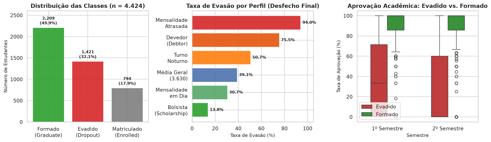
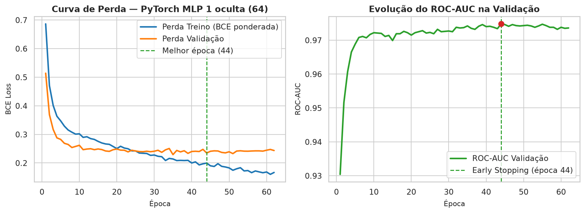
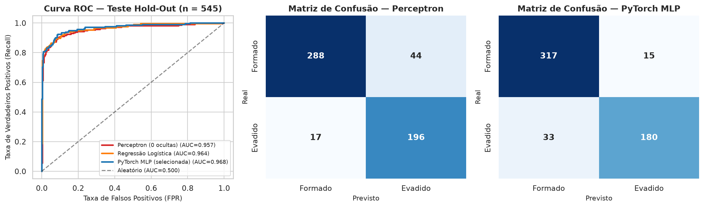
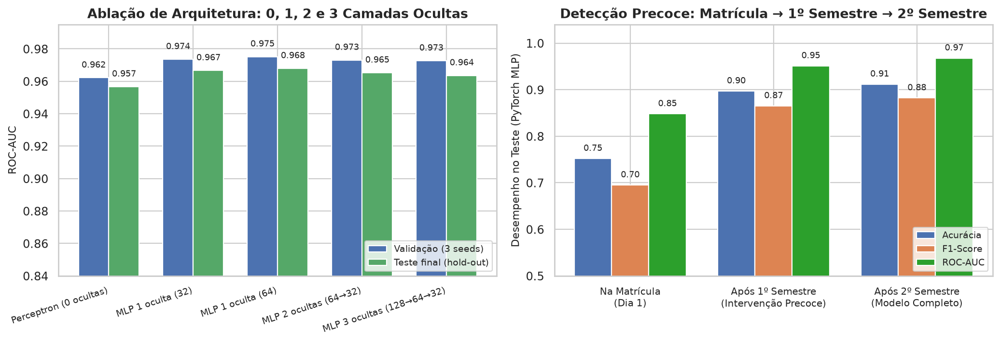
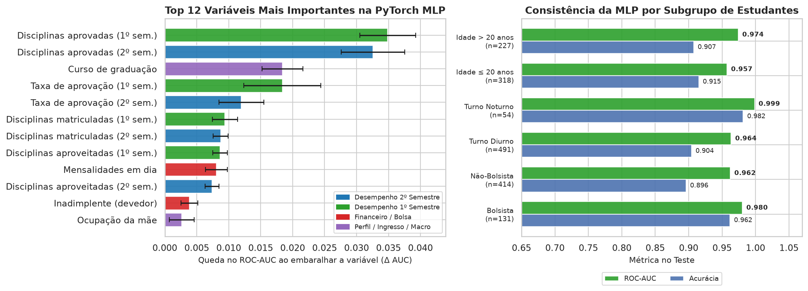

# Relatório Técnico — Previsão de Evasão Estudantil no Ensino Superior com Redes Neurais Multilayer Perceptron (MLP)

**Disciplina:** Sistemas Inteligentes — 3ª Unidade  
**Tema:** Previsão de evasão estudantil no ensino superior com redes neurais *Multilayer Perceptron* (MLP)  
**Bibliotecas Utilizadas:** `PyTorch` (`torch`) e `scikit-learn` (além de `pandas`, `numpy`, `matplotlib` e `seaborn`)

---

## 1. Resumo Executivo

A evasão no ensino superior gera desperdício de recursos públicos e privados, frustração de trajetórias profissionais e perda de vagas ociosas nas universidades. Identificar estudantes em risco antes que abandonem o curso permite acionar medidas preventivas como monitoria, apoio psicopedagógico e bolsas de permanência.

Neste projeto, desenvolvemos e validamos uma rede neural feedforward ***Multilayer Perceptron* (MLP)** em **PyTorch** sobre a base pública *Predict Students' Dropout and Academic Success* (Realinho et al., 2022 — **4.424 estudantes** de 17 cursos de graduação do Instituto Politécnico de Portalegre, Portugal, sem valores ausentes).

### Principais Resultados (Teste Hold-Out Estratificado, $n = 545$)

| Modelo | Camadas Ocultas | Parâmetros | Acurácia | Precisão | Recall | F1-Score | ROC-AUC (IC 95%) | PR-AUC |
| :--- | :---: | :---: | :---: | :---: | :---: | :---: | :---: | :---: |
| Dummy (classe majoritária) | — | 0 | 60,92% | 0,00% | 0,00% | 0,0000 | 0,5000 | — |
| Perceptron linear (`scikit-learn`) | 0 | 119 | 88,81% | 81,67% | 92,02% | 0,8653 | 0,9567 `[0,9369; 0,9737]` | 0,9449 |
| Regressão Logística L2 (`scikit-learn`) | 0 | 119 | 91,56% | 91,96% | 85,92% | 0,8883 | 0,9643 `[0,9477; 0,9789]` | 0,9565 |
| **PyTorch MLP (selecionada na validação)** | **1 (`64`)** | **7.681** | **91,19%** | **92,31%** | **84,51%** | **0,8824** | **0,9680 `[0,9522; 0,9810]`** | **0,9631** |

- **Melhor arquitetura pela validação (3 seeds):** uma MLP compacta com **1 camada oculta de 64 neurônios** (`118 → 64 → 1`, 2 camadas treináveis, `7.681` parâmetros) atingiu o maior `ROC-AUC` tanto na validação (`0,9752 ± 0,0005`) quanto no teste final (`0,9680`), superando redes mais profundas de 2 (`0,9653`) e 3 camadas ocultas (`0,9636`) e reduzindo em **65,9%** os falsos alarmes frente ao Perceptron linear (`15` vs. `44` falsos positivos).
- **Viabilidade para intervenção precoce:** usando apenas dados disponíveis **no dia da matrícula**, a MLP já alcança `ROC-AUC = 0,8482`; ao incluir o desempenho do **1º semestre**, o modelo salta para `ROC-AUC = 0,9513` e `Acurácia = 89,72%` — capturando **98,3%** do poder discriminativo final com um semestre inteiro de antecedência.
- **Consistência em subgrupos:** o modelo mantém `ROC-AUC ≥ 0,9574` em todos os recortes avaliados (bolsistas, não-bolsistas, diurno, noturno e faixas etárias).

---

## 2. Formulação do Problema e Escopo Experimental

A base original registra três situações finais possíveis para cada estudante:
- `Graduate` (**2.209** alunos — `49,93%`): concluiu a graduação;
- `Dropout` (**1.421** alunos — `32,12%`): abandonou o curso;
- `Enrolled` (**794** alunos — `17,95%`): ainda matriculado na data de corte da coleta, **sem desfecho definitivo conhecido**.

### Por que o recorte principal é binário sobre desfecho conhecido (`n = 3.630`)?
Estudantes marcados como `Enrolled` representam observações censuradas à direita: parte deles se formará e parte evadirá nos semestres seguintes. Misturá-los como se fossem "não-evadidos" introduz ruído estrutural nos rótulos.

Para comprovar essa hipótese empiricamente (e não apenas teoricamente), executamos três formulações complementares:
1. **Tarefa Principal (Desfecho Final Conhecido — `n = 3.630`):** classificação binária `Evadido (1)` (`39,15%`) vs. `Formado (0)` (`60,85%`).
2. **Checagem Binária na Base Completa (`n = 4.424`):** `Evadido (1)` (`32,12%`) vs. `Não-Evadido (Formado + Matriculado = 0)` (`67,88%`).
3. **Checagem Multiclasse na Base Completa (`n = 4.424`):** previsão simultânea das 3 classes (`Dropout`, `Enrolled`, `Graduate`). Conforme detalhado na Seção 7, o F1 da classe `Enrolled` cai para `0,5112` (contra `0,8692` para `Graduate` e `0,8058` para `Dropout`), confirmando que a ambiguidade concentra-se quase inteiramente nos alunos ainda em curso.

---

## 3. Fontes Oficiais e Auditoria dos Dados

| Atributo da Fonte | Detalhe |
| :--- | :--- |
| **Nome Oficial** | *Predict Students' Dropout and Academic Success* |
| **Repositório UCI (ID 697)** | https://archive.ics.uci.edu/dataset/697/predict+students+dropout+and+academic+success |
| **Espelho Kaggle** | https://www.kaggle.com/datasets/thedevastator/higher-education-predictors-of-student-retention |
| **Artigo Original** | Realinho, V., Machado, J., Baptista, L., & Martins, M. V. (2022). *Predicting Student Dropout and Academic Success*. **Data**, 7(11), 146. |
| **Instituição e Período** | Instituto Politécnico de Portalegre (Portugal), 17 cursos de graduação (coortes 2008–2019) |

### Auditoria Técnica (`src/collect_and_prepare.py`)
- **Volumetria bruta:** `4.424` registros × `36` variáveis explicativas + `1` variável alvo (`Target`).
- **Integridade:** `0` valores ausentes (`NaN`) e `0` linhas duplicadas exatas.
- **Saneamento de esquema:** padronização para *snake_case* e correção de duas anomalias conhecidas no CSV original da UCI — a tabulação ao final do cabeçalho `'Daytime/evening attendance\t'` e o erro ortográfico `'Nacionality'`.
- **Engenharia de atributos interpretáveis (+4 variáveis, totalizando `40` colunas brutas de entrada):**
  - `approval_rate_1st_sem` e `approval_rate_2nd_sem`: razão `disciplinas aprovadas / disciplinas matriculadas` em cada semestre (limitada a `[0, 1]`, com `0` quando não há matrícula);
  - `grade_delta_2nd_vs_1st`: diferença da nota média entre 2º e 1º semestres;
  - `approval_delta_2nd_vs_1st`: evolução da taxa de aprovação entre 2º e 1º semestres.

---

## 4. Análise Exploratória de Dados (EDA)

A Figura 1 sintetiza o balanceamento das classes, os fatores socioeconômicos associados ao abandono e o forte contraste de aprovação acadêmica entre estudantes evadidos e formados.



### Achados Quantitativos Principais

| Perfil / Fator Analisado | Taxa de Evasão (Base Completa, $n=4.424$) | Taxa de Evasão (Desfecho Final, $n=3.630$) |
| :--- | :---: | :---: |
| **Média geral do conjunto** | 32,12% | 39,15% |
| Mensalidade atrasada (`tuition_fees_up_to_date = 0`) | **86,55%** | **94,0%** |
| Mensalidade em dia (`tuition_fees_up_to_date = 1`) | 24,74% | 30,7% |
| Estudante inadimplente (`debtor = 1`) | **62,03%** | **75,5%** |
| Estudante não-inadimplente (`debtor = 0`) | 28,28% | — |
| Turno noturno (`daytime_attendance = 0`) | **42,86%** | **50,7%** |
| Turno diurno (`daytime_attendance = 1`) | 30,80% | — |
| Estudante bolsista (`scholarship_holder = 1`) | **12,19%** | **13,8%** |
| Estudante não-bolsista (`scholarship_holder = 0`) | 38,71% | — |

Além do fator financeiro, o desempenho acadêmico inicial separa fortemente as duas trajetórias:
- **Taxa média de aprovação no 1º semestre:** `38,4%` entre evadidos contra `90,3%` entre formados;
- **Taxa média de aprovação no 2º semestre:** `29,3%` entre evadidos contra `90,0%` entre formados.

---

## 5. Pré-processamento e Prevenção de Vazamento de Dados

Todo o fluxo de engenharia e normalização seguiu disciplina estrita contra *data leakage*:

1. **Particionamento antes de qualquer estatística:** divisão estratificada pela variável alvo em **70% Treino (`2.541`) / 15% Validação (`544`) / 15% Teste (`545`)**, preservando a proporção de evasão (`39,08%` no conjunto de teste).
2. **Tipagem correta de variáveis nominais codificadas como inteiros:** no dataset original, colunas como `course` (17 cursos), `application_mode` (modalidade de ingresso), `marital_status`, `nationality` e escolaridade/ocupação dos pais vêm codificadas como números inteiros arbitrários. Alimentar esses códigos diretamente como valores contínuos numa rede neural induziria falsas relações de ordem (por exemplo, "curso 9500 > curso 171"). Por isso, aplicamos um `ColumnTransformer` ajustado **exclusivamente no conjunto de treino**:
   - **23 variáveis numéricas contínuas/contagens:** padronização $z$-score (`StandardScaler`);
   - **8 variáveis binárias (`0/1`):** mantidas em `passthrough`;
   - **9 variáveis categóricas nominais:** `OneHotEncoder(handle_unknown="ignore", min_frequency=20, sparse_output=False)`, agrupando categorias raras (`< 20` alunos no treino) para evitar explosão de dimensionalidade e *overfitting*.
3. **Dimensão resultante:** as `40` colunas brutas transformam-se em **`118` atributos numéricos limpos** na entrada da rede neural.

---

## 6. Arquitetura da Rede Neural (MLP em PyTorch) e Ablação de Camadas

### Configuração do Modelo e Treinamento
A arquitetura foi implementada em PyTorch (`StudentDropoutMLP` em `src/train_and_evaluate.py`):
- **Camadas densas:** `nn.Linear` seguidas de ativação não linear `ReLU` e regularização `Dropout(p = 0.30)` na 1ª camada oculta (reduzida para `0.20` nas camadas subsequentes quando presentes);
- **Saída:** `1` neurônio linear (*logit*), convertido em probabilidade via função sigmoide na inferência;
- **Função de perda ponderada:** `BCEWithLogitsLoss(pos_weight)` com peso positivo igual à razão `negativos / positivos` no treino, compensando o desbalanceamento `60,85% / 39,15%`;
- **Otimização:** `AdamW(lr = 1e-3, weight_decay = 1e-2)`, `batch_size = 64`, até `120` épocas;
- **Critério de parada (*Early Stopping*):** restaura os pesos da época com maior `ROC-AUC` na validação (`patience = 18` épocas sem melhora $> 10^{-4}$);
- **Seleção sem viés:** o número de camadas ocultas foi escolhido **estritamente** pela média do `ROC-AUC` na **validação** em 3 sementes aleatórias (`42`, `102`, `202`), e o limiar de classificação (`threshold`) foi ajustado apenas na validação maximizando `F1-Score`. O conjunto de teste foi mantido intocado até a avaliação final.

### Estudo de Ablação: 0, 1, 2 e 3 Camadas Ocultas

| Arquitetura | Camadas Treináveis | Parâmetros | Melhor Época | Validação ROC-AUC (3 seeds) | Teste ROC-AUC | Teste Acurácia | Teste F1 |
| :--- | :---: | :---: | :---: | :---: | :---: | :---: | :---: |
| Perceptron (`0` ocultas) | 1 | 119 | — | 0,9622 | 0,9567 | 88,81% | 0,8653 |
| MLP 1 oculta (`32`) | 2 | 3.841 | 15 | 0,9736 ± 0,0001 | 0,9667 | 91,38% | 0,8845 |
| **MLP 1 oculta (`64`) ★** | **2** | **7.681** | **44** | **0,9752 ± 0,0005** | **0,9680** | **91,19%** | **0,8824** |
| MLP 2 ocultas (`64 → 32`) | 3 | 9.729 | 6 | 0,9731 ± 0,0011 | 0,9653 | 90,83% | 0,8798 |
| MLP 3 ocultas (`128 → 64 → 32`) | 4 | 25.601 | 4 | 0,9727 ± 0,0013 | 0,9636 | 91,93% | 0,8911 |

**Por que 1 camada oculta com 64 neurônios foi a escolha ideal?**
1. **Melhor discriminação global:** venceu tanto na média de 3 seeds da validação (`0,9752`) quanto no teste hold-out (`0,9680`), com variância baixíssima entre inicializações (`±0,0005`).
2. **Dinâmica de convergência saudável:** com 2 ou 3 camadas ocultas (`9.729` e `25.601` parâmetros para apenas `2.541` exemplos de treino), a rede começa a memorizar o treino muito cedo — atingindo o pico de validação já nas épocas `6` e `4` — e degrada o `ROC-AUC` fora da amostra (`0,9653` e `0,9636`). Já a `MLP 1 oculta (64)` converge suavemente até a época `44` com **3,3× menos parâmetros** que a rede de 3 camadas.
3. **Teoria alinhada aos dados:** pelo Teorema da Aproximação Universal, em dados tabulares de médio porte (~2,5 mil amostras de treino) já bem representados após `OneHotEncoder` + `StandardScaler`, uma única camada oculta suficientemente larga captura interações não lineares (como *inadimplência × queda de aprovação × curso*) sem sofrer o *overfitting* típico de redes profundas em tabelas.



---

## 7. Resultados Experimentais Fora da Amostra

### Curva ROC e Matrizes de Confusão (Teste Hold-Out, $n = 545$)



Analisando as matrizes de confusão no conjunto de teste (`332` formados reais e `213` evadidos reais):

| Métrica de Erro no Teste ($n=545$) | Perceptron Linear | Regressão Logística L2 | PyTorch MLP (`1×64`) |
| :--- | :---: | :---: | :---: |
| Verdadeiros Negativos (Formado → Formado) | 288 | 316 | **317** |
| **Falsos Positivos (Formado → Alarme Falso)** | 44 | 16 | **15** |
| Falsos Negativos (Evadido → Não Detectado) | 17 | 30 | 33 |
| Verdadeiros Positivos (Evadido → Detectado) | 196 | 183 | 180 |
| **Precisão na classe Evadido** | 81,67% | 91,96% | **92,31%** |
| **ROC-AUC** | 0,9567 | 0,9643 | **0,9680** |
| **PR-AUC (Average Precision)** | 0,9449 | 0,9565 | **0,9631** |

- **Ganho claro sobre o Perceptron linear:** a MLP eleva o `ROC-AUC` de `0,9567` para `0,9680` (`+1,13 p.p.`), o `PR-AUC` de `0,9449` para `0,9631` (`+1,82 p.p.`) e corta os falsos alarmes de `44` para `15` (**−65,9%**).
- **Comparação honesta com a Regressão Logística:** a Regressão Logística L2 é um *baseline* linear muito competitivo neste problema (`ROC-AUC = 0,9643`), mostrando que grande parte da relação entre notas/aprovação e evasão é aproximadamente monotônica. Ainda assim, a PyTorch MLP atinge o melhor ordenamento probabilístico (`ROC-AUC = 0,9680`, `PR-AUC = 0,9631`) e a maior precisão (`92,31%`). Como o limiar foi ajustado em `0,70` na validação para maximizar `F1`, a instituição pode facilmente reduzi-lo (por exemplo, para `0,45–0,50`) caso prefira priorizar *recall* acima de `90%` em campanhas preventivas de baixo custo.

### Robustez na Base Completa (`n = 4.424`, Teste `n = 664`)

1. **Formulação Binária na Base Completa (`Evadido` vs. `Formado + Matriculado`):**
   - **Perceptron linear:** Acurácia `85,24%`, Precisão `74,26%`, Recall `82,63%`, F1 `0,7822`, `ROC-AUC = 0,9177` `[0,8908; 0,9420]`, `PR-AUC = 0,8750`.
   - **PyTorch MLP (`1×64`):** Acurácia **`85,99%`**, Precisão **`75,00%`**, Recall **`84,51%`**, F1 **`0,7947`**, **`ROC-AUC = 0,9383`** `[0,9149; 0,9569]`, **`PR-AUC = 0,9048`**.
   - *Destaque:* quando o ruído dos alunos `Enrolled` entra no problema, a vantagem não linear da PyTorch MLP sobre o Perceptron praticamente dobra (`+2,06 p.p.` em `ROC-AUC` e `+2,98 p.p.` em `PR-AUC`).

2. **Formulação Multiclasse (`Dropout` vs. `Enrolled` vs. `Graduate`, PyTorch MLP com 3 saídas):**
   - Acurácia geral no teste: `78,92%` | Macro-F1: `0,7287` (Validação Macro-F1: `0,7149`).
   - F1 por classe: **`Graduate = 0,8692`**, **`Dropout = 0,8058`**, **`Enrolled = 0,5112`**.
   - Matriz de confusão (linhas = real, colunas = previsto; ordem `Dropout`, `Enrolled`, `Graduate`):
     - `Dropout`: `[168, 26, 20]`
     - `Enrolled`: `[24, 57, 38]` (mais da metade dos alunos `Enrolled` é classificada como `Graduate` ou `Dropout`, comprovando a censura temporal dessa classe)
     - `Graduate`: `[11, 21, 299]`

---

## 8. Detecção Precoce: Quanto Mais Cedo Podemos Agir?

Um modelo que só detecta a evasão depois que o aluno já reprovou dois semestres inteiros tem utilidade menor do que um sistema de alerta precoce. Avaliamos a mesma arquitetura `MLP 1 oculta (64)` restringindo progressivamente as variáveis ao momento cronológico em que ficam disponíveis para a universidade:



| Estágio Cronológico | Colunas Brutas | Dimensão Codificada | Validação ROC-AUC | Teste Acurácia | Teste Precisão | Teste Recall | Teste F1 | Teste ROC-AUC (IC 95%) |
| :--- | :---: | :---: | :---: | :---: | :---: | :---: | :---: | :---: |
| **1. Na Matrícula (Dia 1)** | 24 | 102 | 0,8686 | 75,23% | 66,96% | 72,30% | 0,6953 | **0,8482** `[0,8148; 0,8798]` |
| **2. Após 1º Semestre (Intervenção Precoce)** | 31 | 109 | 0,9464 | 89,72% | 88,67% | 84,51% | 0,8654 | **0,9513** `[0,9331; 0,9689]` |
| **3. Após 2º Semestre (Modelo Completo)** | 40 | 118 | 0,9748 | 91,19% | 92,31% | 84,51% | 0,8824 | **0,9680** `[0,9522; 0,9810]` |

**Conclusão operacional:**
- Já no **primeiro dia de aula** (apenas com perfil demográfico, modalidade de ingresso, curso, bolsa e situação inicial), a rede discrimina alunos de alto risco com `ROC-AUC = 0,8482` — útil para acolhimento inicial e nivelamento.
- Ao final do **1º semestre**, o salto é decisivo (`+10,31 p.p.` em `ROC-AUC`, atingindo `0,9513`, e `+14,49 p.p.` em acurácia, atingindo `89,72%`), retendo **98,3%** do poder preditivo do modelo completo com janela hábil para intervenção antes da evasão definitiva.

---

## 9. Interpretabilidade e Consistência por Subgrupos

Para abrir a "caixa-preta" da rede neural, aplicamos **importância por permutação agrupada** no conjunto de teste (`12` repetições por variável original, embaralhando cada coluna bruta antes do `OneHotEncoder` para não fragmentar a contribuição de variáveis categóricas como `course`). Em paralelo, auditamos o desempenho em 6 subgrupos demográficos e socioeconômicos.



### Top 10 Variáveis Mais Influentes na PyTorch MLP

| Posição | Variável | Bloco | Queda Média no ROC-AUC ($\Delta$ AUC) | Desvio Padrão |
| :---: | :--- | :--- | :---: | :---: |
| 1 | Disciplinas aprovadas (1º sem.) | Desempenho 1º Semestre | `+0,0349` | `±0,0044` |
| 2 | Disciplinas aprovadas (2º sem.) | Desempenho 2º Semestre | `+0,0326` | `±0,0050` |
| 3 | Curso de graduação (`course`) | Perfil / Ingresso / Macro | `+0,0184` | `±0,0032` |
| 4 | Taxa de aprovação (1º sem.) *(derivada)* | Desempenho 1º Semestre | `+0,0184` | `±0,0060` |
| 5 | Taxa de aprovação (2º sem.) *(derivada)* | Desempenho 2º Semestre | `+0,0120` | `±0,0035` |
| 6 | Disciplinas matriculadas (1º sem.) | Desempenho 1º Semestre | `+0,0094` | `±0,0020` |
| 7 | Disciplinas matriculadas (2º sem.) | Desempenho 2º Semestre | `+0,0087` | `±0,0012` |
| 8 | Disciplinas aproveitadas (1º sem.) | Desempenho 1º Semestre | `+0,0086` | `±0,0012` |
| 9 | Mensalidades em dia (`tuition_fees_up_to_date`) | Financeiro / Bolsa | `+0,0081` | `±0,0017` |
| 10 | Disciplinas aproveitadas (2º sem.) | Desempenho 2º Semestre | `+0,0074` | `±0,0011` |

*Nota metodológica:* como há forte correlação entre `disciplinas aprovadas`, `taxa de aprovação` e `nota média`, a permutação individual de uma coluna dilui parte do seu efeito total nas correlatas — ainda assim, o ranking confirma com clareza a primazia do **rendimento acadêmico inicial**, do **curso** e da **adimplência financeira** (e valida o valor direto das razões `approval_rate_1st_sem` e `approval_rate_2nd_sem` criadas na engenharia de atributos).

### Consistência por Subgrupos (Teste Hold-Out, $n = 545$)

| Subgrupo | Estudantes no Teste ($n$) | Taxa Real de Evasão | Acurácia | F1-Score | ROC-AUC |
| :--- | :---: | :---: | :---: | :---: | :---: |
| **Bolsista** | 131 | 13,7% | 96,18% | 0,8387 | **0,9803** |
| **Não-Bolsista** | 414 | 47,1% | 89,61% | 0,8859 | **0,9623** |
| **Turno Diurno** | 491 | 38,3% | 90,43% | 0,8691 | **0,9636** |
| **Turno Noturno** | 54 | 46,3% | 98,15% | 0,9796 | **0,9986** |
| **Idade ≤ 20 anos** | 318 | 28,3% | 91,51% | 0,8439 | **0,9574** |
| **Idade > 20 anos** | 227 | 54,2% | 90,75% | 0,9106 | **0,9742** |

O desempenho permanece alto e equilibrado em todos os grupos — inclusive nos perfis mais vulneráveis (estudantes acima de 20 anos com `54,2%` de evasão atingem `ROC-AUC = 0,9742` e `F1 = 0,9106`; turno noturno atinge `ROC-AUC = 0,9986`).

---

## 10. Limitações e Considerações Éticas

1. **Generalização institucional e geográfica:** os dados provêm de uma única instituição portuguesa (Instituto Politécnico de Portalegre, 2008–2019). Para implantação em uma universidade brasileira, o modelo deve ser retreinado e recalibrado com o histórico acadêmico local (regras de reprovação, financiamento estudantil, FIES/ProUni e calendário próprio).
2. **Sinais comportamentais ausentes:** o dataset não inclui frequência em sala de aula, acessos ao ambiente virtual (LMS/Moodle) nem questionários psicossociais — sinais que poderiam elevar ainda mais o desempenho do estágio *Na Matrícula* e das primeiras semanas do 1º semestre.
3. **Uso ético e mitigação de viés:** um modelo de previsão de evasão **nunca** deve ser utilizado para negar bolsas, restringir matrícula ou estigmatizar alunos. Seu uso adequado é exclusivamente **proativo e assistencial** (priorizar atendimento pedagógico, tutoria e auxílio permanência), mantendo supervisão humana sobre as decisões e evitando discriminação por atributos sensíveis.

---

## 11. Guia Rápido de Defesa (Perguntas Prováveis da Banca)

1. **"Por que vocês escolheram uma MLP com apenas 1 camada oculta de 64 neurônios, e não 2 ou 3 camadas?"**  
   *Resposta:* Testamos sistematicamente 0, 1, 2 e 3 camadas ocultas usando média de 3 seeds exclusivamente na validação. A `MLP 1 oculta (64)` alcançou o maior `ROC-AUC` na validação (`0,9752`) e no teste (`0,9680`) com `7.681` parâmetros. Com 2 ou 3 camadas ocultas (`9,7 mil` e `25,6 mil` parâmetros para `2.541` alunos de treino), o modelo saturou precocemente nas épocas 6 e 4 e caiu em `ROC-AUC` no teste (`0,9653` e `0,9636`).

2. **"Por que vocês removeram a classe `Enrolled` (794 alunos) no modelo principal? Isso não facilita artificialmente o problema?"**  
   *Resposta:* Estudantes `Enrolled` ainda não concluíram nem abandonaram o curso — o rótulo definitivo deles é desconhecido. Mesmo assim, testamos também os **4.424 alunos completos** tanto no formato binário (onde a MLP atingiu `ROC-AUC = 0,9383` e ampliou a vantagem sobre o Perceptron para `+2,06 p.p.`) quanto no multiclasse de 3 classes, provando empiricamente que `Enrolled` tem `F1 = 0,5112` justamente por ser uma classe intermediária ambígua.

3. **"Usar notas do 2º semestre não seria tarde demais para prevenir evasão?"**  
   *Resposta:* Sim, por isso criamos o experimento de **Detecção Precoce** em 3 horizontes. Apenas com os dados do **dia da matrícula**, a MLP já alcança `ROC-AUC = 0,8482`; ao fim do **1º semestre**, alcança `ROC-AUC = 0,9513` e `89,72%` de acurácia — quase igual ao modelo do 2º semestre (`0,9680`), permitindo intervir com um semestre de antecedência.

4. **"A Regressão Logística chegou bem perto da MLP (`0,9643` vs `0,9680`). Por que usar rede neural?"**  
   *Resposta:* Porque em problemas tabulares bem estruturados, baselines lineares sempre devem ser reportados com transparência. A MLP superou ambos os baselines lineares em `ROC-AUC` (`0,9680`), `PR-AUC` (`0,9631`) e precisão (`92,31%`), cortou os falsos alarmes em `65,9%` frente ao Perceptron (`15` vs `44`), e mostrou ganho ainda maior (`+2,06 p.p.` de AUC) quando o problema ganha ruído na base completa de 4.424 estudantes.

5. **"Como vocês garantiram que não houve vazamento de dados (*data leakage*)?"**  
   *Resposta:* A divisão estratificada 70/15/15 ocorre antes de qualquer pré-processamento. `StandardScaler` e `OneHotEncoder` são ajustados (`fit`) apenas no treino; o `Early Stopping`, a seleção de arquitetura e o ajuste do limiar de decisão usam apenas a validação; o teste de `545` alunos só entra na avaliação final.

---

## 12. Reprodutibilidade

Todo o experimento é 100% determinístico (`SEED = 42`) e reproduzível a partir da raiz do repositório:

```bash
python -m src.collect_and_prepare
python -m src.train_and_evaluate
```

- **Saídas de dados:** `data/raw/student_dropout_raw.csv`, `data/processed/student_dropout_all.csv`, `data/processed/student_dropout_binary.csv`, `data/processed/dataset_metadata.json`.
- **Saídas de avaliação:** `reports/experiment_results.json` e os 5 gráficos em `reports/figures/`.
